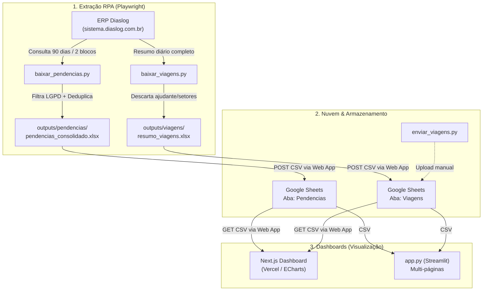

# 📦 Central de Indicadores | Dias+ (Dashboard & Automação)

Sistema automatizado de extração, consolidação e visualização de indicadores logísticos (entregas, pendências, viagens e ocorrências) integrado ao ERP **Diaslog** e conectado ao **Google Sheets** em tempo real.

---

## 🎯 Visão Geral da Arquitetura

O ecossistema opera em três camadas integradas:



---

## 📁 Estrutura de Arquivos

```text
├── src/app/page.tsx         # Dashboard web Next.js com gráficos ECharts e filtros interativos
├── src/lib/data-service.ts  # Leitura e consolidação das abas Viagens e Pendencias
├── app.py                   # Roteador multipágina da aplicação Streamlit
├── comum.py                 # Funções compartilhadas (CSS, paleta, gráficos e regras logísticas)
├── paginas/
│   ├── pendencias.py        # Página Streamlit: análise de notas pendentes, atrasos e riscos
│   └── entregas.py          # Página Streamlit: performance de viagens, motoristas e insucessos
├── baixar_pendencias.py     # RPA Playwright: extrai notas pendentes (90 dias) e sobe ao Sheets
├── baixar_viagens.py        # RPA Playwright: extrai resumo de viagens diárias e sobe ao Sheets
├── enviar_viagens.py        # Script utilitário para envio avulso de planilhas ao Google Sheets
├── executar_rotina.py       # Orquestrador Python: executa o fluxo completo (Viagens + Pendências)
├── executar_rotina.bat      # Atalho executável para o Agendador de Tarefas do Windows
├── .env.example             # Modelo das variáveis de ambiente necessárias
└── .gitignore               # Proteção contra commit de credenciais (.env) e planilhas (.xlsx)
```

---

## ⚙️ Pré-requisitos e Instalação

### 1. Requisitos
- **Python 3.10+** instalado no Windows.
- Navegador **Microsoft Edge** ou **Google Chrome**.

### 2. Instalação das dependências
Abra o prompt de comando ou terminal na pasta do projeto e instale as bibliotecas necessárias:

```bash
pip install playwright pandas openpyxl streamlit plotly
```

Instale os navegadores gerenciados pelo Playwright:
```bash
playwright install
```

### 3. Configuração do Arquivo `.env`
Crie um arquivo chamado `.env` na raiz do projeto (baseando-se no `.env.example`):

```ini
# Credenciais do ERP Diaslog
DIASLOG_USUARIO=seu_usuario
DIASLOG_SENHA=sua_senha

# Endpoint do Google Apps Script Web App (Planilha Google Sheets)
SHEETS_WEBAPP_URL=https://script.google.com/macros/s/AKfycb.../exec
SHEETS_WEBAPP_TOKEN=seu_token_secreto
```

> **Aviso de Segurança:** O arquivo `.env` contém credenciais e jamais deve ser compartilhado ou enviado ao repositório Git.

---

## 🚀 Como Usar

### Dashboard web Next.js

O dashboard principal usa os dados da pasta de trabalho configurada em `SHEETS_WEBAPP_URL`.
As abas `Viagens` e `Pendencias` são lidas no servidor pelo Web App; abas ausentes ou vazias
não geram gráficos vazios nem são substituídas por dados fictícios.

1. Instale o Node.js 20.9+ e as dependências do projeto:
   ```bash
   npm install
   ```
2. Configure `SHEETS_WEBAPP_URL` no arquivo `.env` (ou nas variáveis do projeto na Vercel).
3. Inicie o dashboard local:
   ```bash
   npm run dev
   ```
4. Abra `http://localhost:3000`.

O período e a filial podem ser filtrados pela interface. Os gráficos ECharts oferecem zoom,
restauração e exportação de imagem; o botão **Exportar CSV** baixa o consolidado de filiais
correspondente ao filtro atual.

### Opção 1: Executar a Automação Completa (Robô RPA)

Para rodar todo o fluxo de uma vez (baixar viagens do dia + baixar pendências de 90 dias + subir tudo para o Google Sheets):

- **Pelo Terminal:**
  ```bash
  py executar_rotina.py
  ```
- **Ou clique duas vezes em:** `executar_rotina.bat`.

> **Dica:** Para rodar de forma invisível em segundo plano (sem abrir janelas de navegador), configure `HEADLESS = True` nos arquivos `baixar_pendencias.py` e `baixar_viagens.py`.

---

### Opção 2: Visualizar pelo Streamlit (`app.py`)

Se preferir a interface Python com tabelas interativas:

```bash
streamlit run app.py
```

O aplicativo abrirá no navegador padrão em `http://localhost:8501`, permitindo alternar entre as abas:
- **📦 Pendências:** Visão de notas em aberto, SLA de entrega, criticidade de atraso e valor financeiro retido.
- **🚚 Entregas:** Produtividade de viagens, taxas de sucesso e motivos de insucesso.

---

## ⏰ Como Agendar no Windows (Task Scheduler)

Para que o robô atualize o dashboard automaticamente todos os dias sem intervenção manual:

1. Pressione `Win + R`, digite `taskschd.msc` e pressione Enter.
2. Clique em **Criar Tarefa Básica**.
3. Defina um nome (ex.: `Diaslog - Atualizacao Indicadores`).

4. Escolha o disparador (ex.: **Diariamente** às `06:00` e repetindo a cada 4 horas).
5. Na ação, escolha **Iniciar um programa**:
   - **Programa/script:** `C:\Users\Antenor.Hugo\Downloads\retorno\executar_rotina.bat`
   - **Iniciar em (obrigatório):** `C:\Users\Antenor.Hugo\Downloads\retorno\`
6. Salve a tarefa.

---

## 🛡️ Tratamento de Dados e LGPD

Os robôs removem automaticamente colunas que contenham dados pessoais de pessoas físicas antes de qualquer upload para o Google Sheets:
- Nomes de ajudantes e destinatários finais.
- Telefones, endereços e CEPs residenciais.
- Apenas as informações estritamente operacionais (NF, Filial, Datas, Motorista, Ocorrências, Peso e Valor) são persistidas na nuvem.
